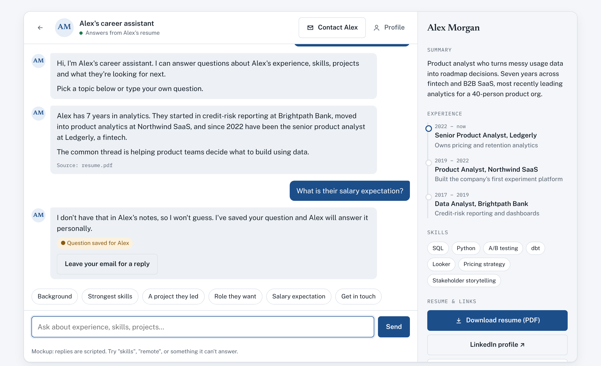
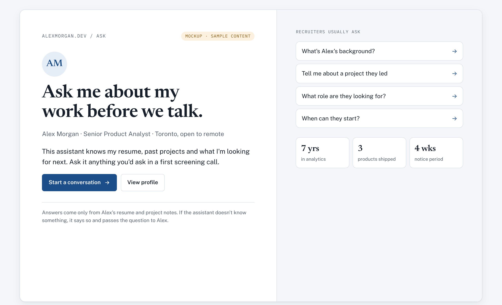
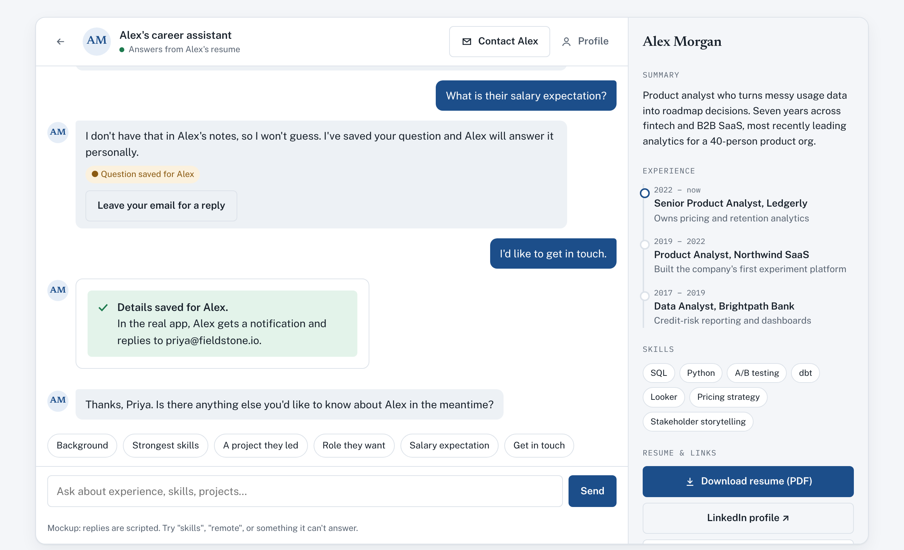
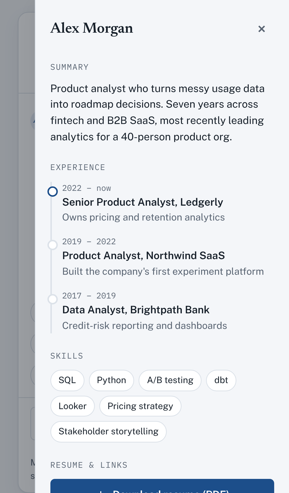

# Career Conversation Chatbot

An AI assistant that sits on my portfolio site and answers recruiters' questions about my experience, skills and projects. You get the answers a first screening call would give, without waiting for one.

> **Project status: design stage.** This repo currently contains a clickable UI mockup with sample content and scripted replies. The AI backend is not built yet. See the [roadmap](#roadmap) for what's planned.



## The problem it solves

Recruiters spend a few minutes on each candidate. A resume can't answer follow-up questions like *"What did they actually own on that project?"* or *"Are they open to remote work?"*. This chatbot answers those questions on the spot, using only my real resume and project notes. When it doesn't know something, it says so and passes the question to me.

## How it works (planned design)

1. **The visitor asks a question** in the chat, or picks a suggested one.
2. **The assistant answers from my documents only** (resume, project notes, career goals) and shows which document each answer came from.
3. **If it doesn't know, it doesn't guess.** It saves the question and tells me, so I can answer it personally.
4. **Visitors can leave their contact details** in the chat, and I get notified.

The rule against guessing is deliberate. A chatbot that makes up a salary figure or a skill does more damage to a candidate than having no chatbot at all.

## Screens in the mockup

| Welcome | Contact capture | Profile on mobile |
|---|---|---|
|  |  |  |

- **Welcome:** short intro, the questions recruiters usually ask, and key facts at a glance.
- **Chat:** suggested topics, answers with their source, and honest "I don't know" replies.
- **Contact capture:** an inline form with email validation, so visitors never leave the conversation.
- **Profile panel:** summary, experience timeline, skills and a resume download. It sits beside the chat on desktop and slides in as a drawer on phones.

The mockup uses a fictional candidate ("Alex Morgan") as placeholder content.

## Try the mockup

It's a single HTML file with no build step and no dependencies.

```bash
git clone https://github.com/pdixita186/career-conversation-chatbot.git
```

Then open `mockup/index.html` in any browser. Things to try:

- Click a suggested question, or type "skills" or "remote".
- Ask something it can't answer, like a salary question, to see the honest fallback.
- Click **Contact Alex** to see the contact form.
- Make the window narrow to see the mobile layout.

## Tech stack

| Part | Mockup (now) | Planned |
|---|---|---|
| Interface | HTML, CSS, vanilla JavaScript | Gradio |
| Backend | none (scripted replies) | Python |
| AI | none | LLM API (OpenAI or Claude) with my documents as context |
| Notifications | none | Push notification when a question goes unanswered or a visitor leaves contact details |
| Hosting | open the file locally | Hugging Face Spaces |

## Roadmap

- [x] Clickable UI mockup: welcome, chat, contact capture and profile screens
- [ ] Replace the sample content with my real resume and project notes
- [ ] Python backend that sends each question to an LLM, with my documents as context
- [ ] "Don't guess" behavior: log unknown questions and notify me
- [ ] Save contact details and send me a notification
- [ ] Gradio interface based on the mockup
- [ ] Deploy publicly and link it from my portfolio
- [ ] Measure how many questions get answered vs. passed to me, and fill the gaps

## Project structure

```
career-conversation-chatbot/
├── mockup/
│   └── index.html        # Clickable UI mockup (single file)
├── docs/
│   └── screenshots/      # Images used in this README
└── README.md
```

## Author

Built by [@pdixita186](https://github.com/pdixita186). If you're a recruiter reading this, the finished chatbot will answer your questions directly. Until then, reach out through my GitHub profile.
